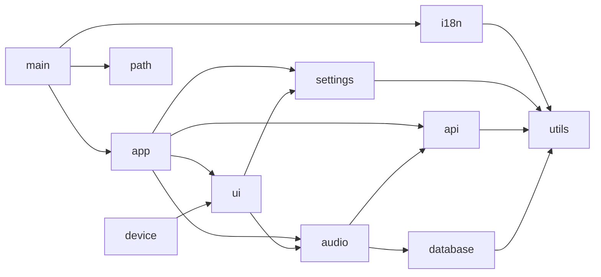
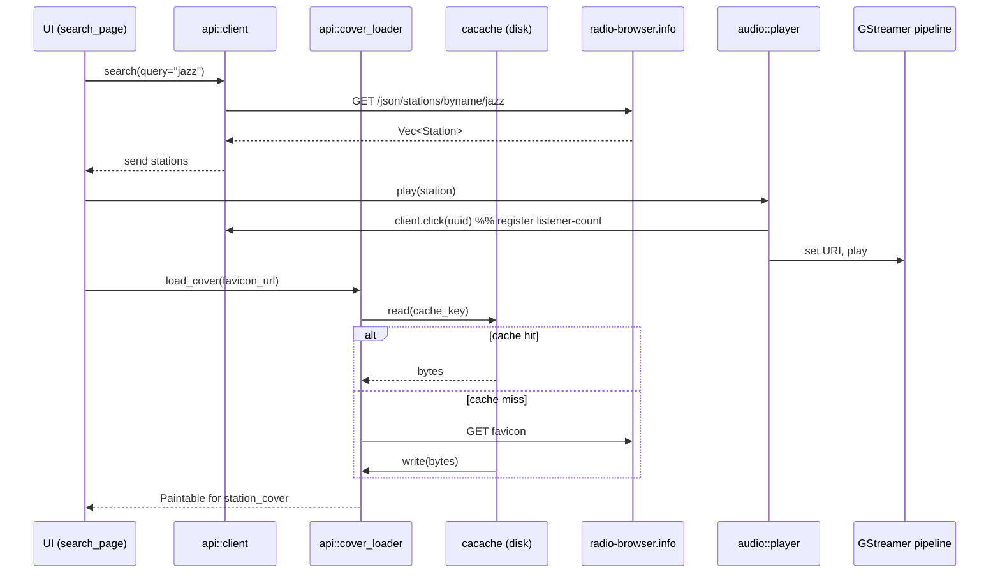
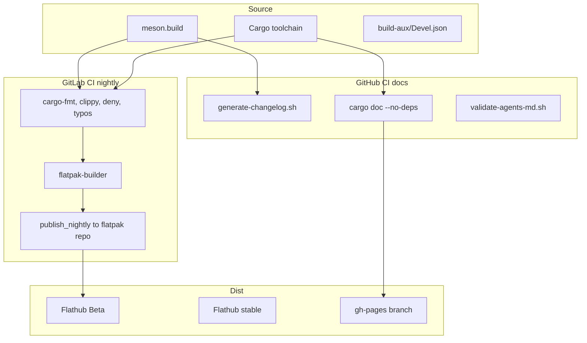

# Animawave Architecture

Animawave is a GTK/libadwaita desktop internet-radio player for the [radio-browser.info](https://radio-browser.info/) catalogue. Build system is Meson with Rust; packaging is Flatpak (GNOME Nightly + Flathub).

## External dependencies

| System | Purpose |
|---|---|
| `radio-browser.info` HTTP JSON | Station search, vote, click tracking, tag browsing |
| `glycin` crate + loaders | Decoding station-icon PNG/JPEG from raw bytes |
| GStreamer (`gstreamer`, `gstreamer-audio`) | Playback pipeline: decodebin -> audioconvert -> pulsesink/pipewiresink |
| GSettings (`libadwaita::Preferences`) | User preferences, key bindings, window state |
| SQLite (`diesel` 2.x + bundled migrations) | Local station library, playback history |
| GUPnP (`cast-sender`) | Chromecast / network-radio device discovery |
| D-Bus MPRIS (`mpris-server`) | System media-keys, tray UI integration |

## Module topology



## Station-load flow



## Build and distribution paths



## Data flow summary

```
User clicks station
  -> ui/event handler (channel::Sender<PlayerAction>)
    -> audio::player (GStreamer pipeline + recording)
      -> audio::gstreamer_backend (preroll, buffering, reconnect)
      -> database::library (last_played, history)
      -> device::cast_sender (optional — GUPnP Chromecast UI trigger)

Preferences change (GSettings notify)
  -> settings::settings_manager (Key enum, dbus proxy)
    -> audio_pipeline (reconfigure GST under the hood)
    -> ui (re-render SwitchRow / window state)
```

## Conventions

- Async tasks use `async-std` + `async-channel`. GStreamer callbacks must cross threads via `clone!(@weak obj => async move { ... })` — never touch GTK from a GStreamer bus callback.
- Database migrations live under `data/database/migrations/NNNN/`. New migrations are embedded at build time via `diesel_migrations::embed_migrations!`.
- Settings keys are defined once in `src/settings/settings_manager.rs::Key` (enum) and de/serialized into GSettings schemas under `data/`.

## Deployment observability

- Flathub Beta dashboard: https://flathub.org/apps/de.haeckerfelix.Animawave.Devel
- Flathub stable dashboard: https://flathub.org/apps/de.haeckerfelix.Animawave
- GitLab CI pipelines (Flatpak build): https://gitlab.gnome.org/haeckerfelix/animawave/-/pipelines
- GitHub Actions: https://github.com/animaios/animawave/actions

After a release tag is pushed here, the nightly job publishes to Flathub Beta. Promotion to stable is manual via the Flathub PR process — see RUNBOOKS.md.
